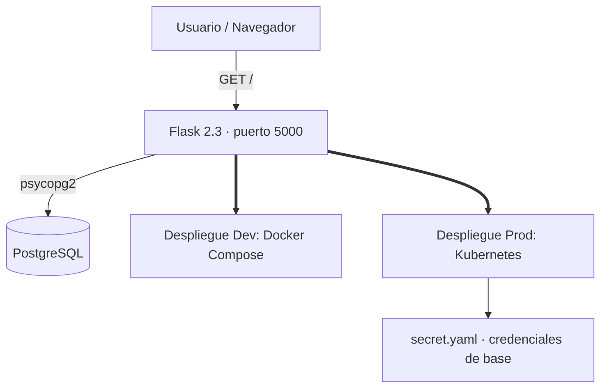

# python-kube-app

Aplicación Flask mínima que consulta PostgreSQL y sirve el resultado por HTTP, lista para desplegarse con **Docker Compose** o sobre **Kubernetes**.

[](https://python.org)
[](https://flask.palletsprojects.com)

## Contenido

- [Características](#características)
- [Arquitectura](#arquitectura)
- [Stack](#stack)
- [Estructura del repositorio](#estructura-del-repositorio)
- [Instalación](#instalación)
- [Despliegue](#despliegue)
- [Configuración](#configuración)
- [Roadmap](#roadmap)
- [Licencia](#licencia)

## Características

- Endpoint `GET /` que ejecuta una consulta contra PostgreSQL y devuelve el valor obtenido.
- Configuración de la base de datos 100% vía variables de entorno (con defaults locales).
- Despliegue en dos modalidades:
  - **Docker Compose**: aplicación + base de datos en un solo comando.
  - **Kubernetes**: manifiestos para app (`deployment`, `service`), PostgreSQL y `secret`.
- Manejo de errores de conexión a la base de datos (respuesta legible en HTTP).

## Arquitectura



## Stack

| Componente   | Tecnología                                  |
|--------------|---------------------------------------------|
| Backend      | Python 3, Flask 2.3.3                       |
| Base de datos| PostgreSQL (`psycopg2-binary`)              |
| Orquestación | Docker Compose · Kubernetes                 |

## Estructura del repositorio

```
python-kube-app/
├── app.py                       # App Flask + consulta a PostgreSQL
├── Dockerfile
├── docker-compose.yml           # app + postgres
├── requirements.txt
└── k8s/
    ├── deployment.yaml          # Deployment de la app Flask
    ├── service.yaml             # Service de la app
    ├── postgres-deployment.yaml # Deployment de PostgreSQL
    ├── postgres-service.yaml    # Service de PostgreSQL
    └── secret.yaml              # Secret con la contraseña
```

## Instalación

```bash
git clone https://github.com/bi0punk/python-kube-app.git
cd python-kube-app
python -m venv .venv && source .venv/bin/activate
pip install -r requirements.txt

export DB_HOST=localhost DB_NAME=flaskdb DB_USER=flaskuser DB_PASSWORD=flaskpass
python app.py        # http://localhost:5000
```

## Despliegue

**Docker Compose:**

```bash
docker compose up -d
curl http://localhost:5000
```

**Kubernetes:**

```bash
docker build -t flask-kube-app .
kubectl apply -f k8s/
kubectl port-forward svc/flask-service 5000:5000
curl http://localhost:5000
```

## Configuración

| Variable      | Default     | Descripción                 |
|---------------|-------------|-----------------------------|
| `DB_HOST`     | `localhost` | Host de PostgreSQL          |
| `DB_NAME`     | `flaskdb`   | Nombre de la base de datos  |
| `DB_USER`     | `flaskuser` | Usuario de la base de datos |
| `DB_PASSWORD` | `flaskpass` | Contraseña                  |

## Roadmap

- [x] Endpoint `/` con consulta a PostgreSQL
- [x] Manifiestos Kubernetes (app, postgres, secret)
- [ ] Healthchecks de liveness/readiness en Kubernetes
- [ ] Volumen persistente para PostgreSQL
- [ ] Pipeline CI básico con build de imagen
- [ ] Ingress con HTTPS

## Licencia

Sin archivo `LICENSE` declarado en el repositorio.